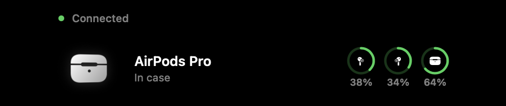

<p align="center"></p>

<h1 align="center">Остров · Island</h1>

<p align="center">Динамический остров для Mac — живая плашка у выреза экрана.<br>
A Dynamic Island for the Mac notch.</p>

<p align="center"><a href="#english">English below</a></p>

<p align="center">
  <br>
  <sub>Claude Code работает, рядом играет музыка · Claude Code at work while music plays</sub>
</p>
<p align="center">
  
  <br>
  <sub>AirPods: в ушах и в кейсе · in ears and in the case</sub>
</p>
<p align="center">
  <br>
  <sub>Уведомление из любого приложения или своего скрипта · A notification from any app or your own script</sub>
</p>

---

## Что умеет

| | |
|---|---|
| **Claude Code** | Пока Claude работает — строка под вырезом: проект, что делается сейчас («Правлю Model.swift», «Ищу в сети…»), таймер; справа от выреза крутится искра Claude. Несколько сессий — счётчик ×N. По окончании — уведомление с итогом. |
| **Искра Claude** | Живёт справа от выреза и в покое — значок Claude из строки меню можно убрать. |
| **Музыка** | «Музыка» и Spotify: обложка слева от выреза. При наведении — плеер: перемешать, назад, пауза, вперёд, повтор, прогресс. Пока играет музыка, остров не растягивается от длинного текста. |
| **AirPods** | При подключении — объёмные наушники или кейс (если наушники в кейсе), заряд левого, правого и кейса. Нажатие открывает системное меню «Звук»: выход, прозрачность, шумоподавление, распознавание разговора. |
| **Уведомления** | Уведомления любых приложений; у Telegram — с аватаркой отправителя. Клик открывает приложение. |
| **Громкость, устройства, зарядка, фокус** | Своя плашка громкости, подключение наушников и колонок, начало зарядки, режимы фокуса. |
| **Наведение** | Раскрывается: дата, батарея, плеер, громкость и выход звука, сессии Claude по центру. |
| **Русский и English** | Язык как в системе, переключается в меню. |

На Mac без выреза остров рисуется плашкой у верхнего края по центру.

## Настройки — правый клик по острову

| Пункт | Что можно |
|---|---|
| Запускать при входе | Вкл / выкл |
| Прозрачность | Выключена, лёгкая, средняя, сильная |
| Уведомления | Уведомления приложений, уведомления Claude Code, тишина в режиме фокуса, время на экране (4 / 6 / 10 с) |
| Плеер | Показывать музыку у выреза; источник — Музыка и Spotify, только Spotify, только Музыка; справа от выреза — искра Claude или эквалайзер |
| Язык | Русский / English |

## Установка

Нужны macOS 14+ и Command Line Tools (`xcode-select --install`). Xcode не обязателен.

```bash
git clone https://github.com/gidrokuper/island.git
cd island
bash make-cert.sh          # один раз: локальный сертификат подписи
bash build.sh --install    # собрать, положить в ~/Applications и запустить
```

`build.sh` без флагов только собирает в `build/`, с `--run` — собирает и запускает оттуда.

### Разрешения

| Разрешение | Зачем |
|---|---|
| Полный доступ к диску | Читать Центр уведомлений и режимы фокуса (только чтение) |
| Универсальный доступ | Клавиши громкости и меню «Звук» по нажатию на наушники |
| Автоматизация (Музыка, Spotify) | Узнавать, что играет, и переключать треки |

Сертификат из `make-cert.sh` нужен, чтобы macOS не забывала разрешения после каждой пересборки. Он самоподписанный и живёт только на вашем Mac.

### Подключить к Claude Code

```bash
bash install-hooks.sh
```

Добавляет хуки в `~/.claude/settings.json` (с резервной копией `settings.json.bak-island`), чужие хуки не трогает, повторный запуск ничего не дублирует.

### Команды

```bash
I=~/Applications/Island.app/Contents/MacOS/Island
$I notify "Сборка" "Готово за 42 с"   # своё уведомление
$I demo airpods                       # показать подключение AirPods (или: demo case)
$I soundmenu                          # открыть меню «Звук»
```

## Приватность

Остров ничего не отправляет в сеть, кроме загрузки обложки трека Spotify с серверов Spotify. Уведомления читаются локально и нигде не сохраняются. В переписку Telegram и другие приложения он не лезет — берёт только то, что уже показано в уведомлении.

## Как устроено

Swift + SwiftUI, без сторонних зависимостей, Swift Package Manager.

| Файл | Что внутри |
|---|---|
| `main.swift` | Окно-панель над вырезом, мышь, меню настроек |
| `Model.swift` | Состояние и режимы острова, музыка, батарея, события Claude |
| `IslandView.swift` | Отрисовка: форма выреза, анимации, плеер, уведомления, AirPods |
| `Prefs.swift`, `Lang.swift` | Настройки и язык |
| `SystemNotifications.swift` | Чтение Центра уведомлений |
| `SoundMenu.swift` | Открытие системного меню «Звук» |
| `CLI.swift` | `Island hook`, `notify`, `demo`, `soundmenu` |
| `Sound.swift`, `MediaKeys.swift` | Громкость, устройства, AirPods, клавиши |
| `Focus.swift` | Режимы фокуса |

## Под себя

Код открыт — берите и меняйте как нравится. Новый режим — это случай в `IslandModel.Mode`, размер в `bodySize` и вид в `IslandView.content`; новая строка интерфейса — `L("по-русски", "in English")`. Идеи и исправления — через Issues и Pull Requests.

## Лицензия

[MIT](LICENSE)

---

<a id="english"></a>

## English

**Island** turns the Mac notch into a live Dynamic Island.

| | |
|---|---|
| **Claude Code** | While Claude works: project, current action (“Editing Model.swift”, “Web search…”) and a timer under the notch, with the Claude spark spinning on the right. Several sessions show ×N. A summary notification when it's done. |
| **Claude spark** | Sits right of the notch even when idle, so you can hide Claude's menu bar icon. |
| **Music** | Music and Spotify: artwork left of the notch. Hover for a player with shuffle, previous, play/pause, next, repeat and progress. Long text never stretches the island while music plays. |
| **AirPods** | On connect: 3D earbuds or the case (when they're in it), with left, right and case battery. Click to open the system Sound menu — output, Transparency, Noise Cancellation, Conversation Awareness. |
| **Notifications** | From any app; Telegram shows the sender's avatar. Click to open the app. |
| **Volume, devices, charging, Focus** | Custom volume HUD, headphone and speaker connections, charging, Focus modes. |
| **Hover** | Expands: date, battery, player, volume and output, Claude sessions centered. |

**Settings** (right-click the island): Open at Login · Transparency (off / light / medium / strong) · Notifications (apps, Claude Code, silence during Focus, time on screen) · Player (show music, source, spark or equalizer on the right) · Language (English / Русский, follows the system by default).

**Install:** macOS 14+ and Command Line Tools, then

```bash
git clone https://github.com/gidrokuper/island.git && cd island
bash make-cert.sh && bash build.sh --install
bash install-hooks.sh   # connect Claude Code
```

`make-cert.sh` creates a local self-signed signing certificate so macOS keeps Full Disk Access and Accessibility across rebuilds. Permissions: Full Disk Access (read the Notification Center and Focus, read-only), Accessibility (volume keys, opening the Sound menu), Automation (Music, Spotify).

**Privacy:** nothing leaves your Mac except Spotify artwork downloads. Notifications are read locally and never stored.

Swift + SwiftUI, no dependencies. MIT licensed — fork it and make it yours. New UI strings go through `L("по-русски", "in English")`.
