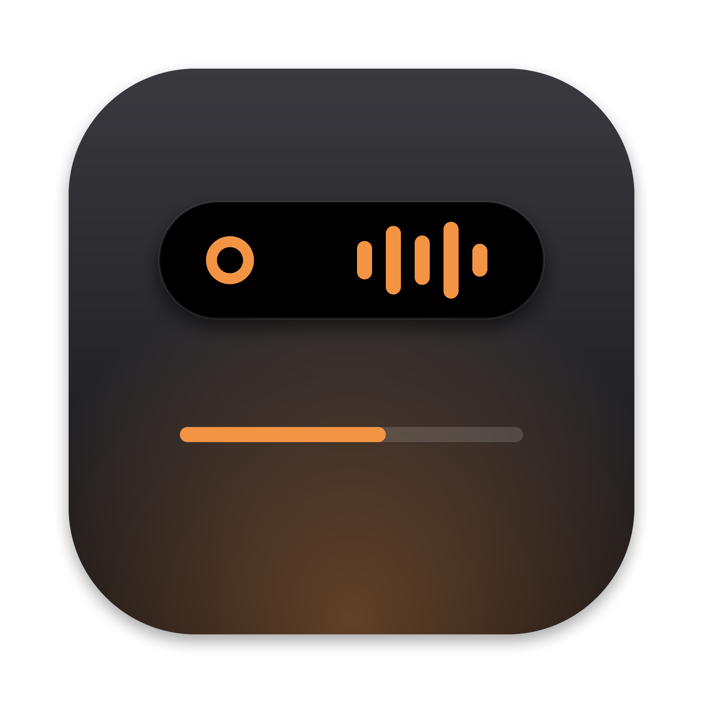
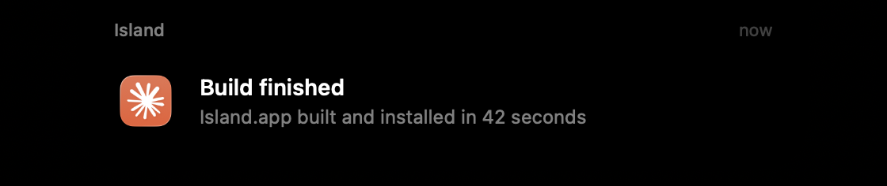

<p align="center"></p>

<h1 align="center">Остров</h1>

<p align="center">Динамический остров для Mac: живая плашка у выреза экрана.<br>
Показывает, что делает Claude Code, что играет, уведомления, громкость и зарядку.</p>

<p align="center"><a href="#english">English below</a></p>

<p align="center">
  <br>
  <sub>Claude Code правит файл, рядом играет музыка</sub>
</p>
<p align="center">
  <br>
  <sub>Уведомление — из любого приложения или своего скрипта</sub>
</p>

---

## Что умеет

| | |
|---|---|
| **Claude Code** | Пока Claude работает — одной строкой под вырезом: проект, что делается сейчас («Читаю Model.swift», «Ищу в сети…»), таймер. Несколько сессий — счётчик ×N. По окончании — уведомление с итогом. |
| **Музыка** | «Музыка» и Spotify: обложка и эквалайзер по бокам выреза. При наведении — плеер: перемешать, назад, пауза, вперёд, повтор, прогресс трека. |
| **Уведомления** | Уведомления любых приложений из Центра уведомлений. Для Telegram — с аватаркой отправителя. Клик открывает приложение. |
| **Громкость** | Своя плашка громкости вместо системной (клавиши громкости). |
| **AirPods** | При подключении — объёмные наушники или кейс (если наушники в кейсе), плавно поворачиваются. Заряд левого, правого и кейса кольцами. Нажатие открывает системное меню «Звук»: выход, режим прослушивания (прозрачность, шумоподавление), распознавание разговора. |
| **Устройства и зарядка** | Подключение других наушников и колонок, начало зарядки. |
| **Режимы фокуса** | Включение и выключение фокуса; во время фокуса уведомления не показываются. |
| **Наведение** | Раскрывается: дата, батарея, плеер, активные сессии Claude. |

На Mac без выреза остров рисуется плашкой у верхнего края по центру.

## Установка

Нужны macOS 14+ и Command Line Tools (`xcode-select --install`). Xcode не обязателен.

```bash
git clone https://github.com/gidrokuper/island.git
cd island
bash make-cert.sh          # один раз: локальный сертификат подписи (необязательно, но удобно)
bash build.sh --install    # собрать, положить в ~/Applications и запустить
```

`build.sh` без флагов только собирает в `build/`, с `--run` — собирает и запускает оттуда.

### Разрешения

macOS спросит их сама, а если нет — «Системные настройки → Конфиденциальность и безопасность»:

| Разрешение | Зачем |
|---|---|
| Полный доступ к диску | Читать базу Центра уведомлений и режимы фокуса (только чтение) |
| Универсальный доступ | Перехватывать клавиши громкости и открывать меню «Звук» по нажатию на наушники |
| Автоматизация (Музыка, Spotify) | Узнавать, что играет, и переключать треки |

Без сертификата из `make-cert.sh` macOS будет забывать разрешения после каждой пересборки.

### Подключить к Claude Code

```bash
bash install-hooks.sh
```

Добавляет хуки в `~/.claude/settings.json` (с резервной копией `settings.json.bak-island`), чужие хуки не трогает, повторный запуск ничего не дублирует.

### Своё уведомление из любого скрипта

```bash
~/Applications/Island.app/Contents/MacOS/Island notify "Сборка" "Готово за 42 с"
```

Посмотреть анимацию AirPods без переподключения: `Island demo airpods` или `Island demo case`.

Правый клик по острову — меню: запуск при входе, проверочное уведомление, выход.

## Приватность

Остров ничего не отправляет в сеть, кроме загрузки обложки трека Spotify с серверов Spotify. Уведомления читаются локально и нигде не сохраняются. В переписку Telegram и другие приложения он не лезет — берёт только то, что уже показано в уведомлении.

## Как устроено

Swift + SwiftUI, без сторонних зависимостей, сборка через Swift Package Manager.

| Файл | Что внутри |
|---|---|
| `main.swift` | Окно-панель над вырезом, мышь, меню |
| `Model.swift` | Состояние и режимы острова, музыка, батарея, события Claude |
| `IslandView.swift` | Вся отрисовка: форма выреза, анимации, плеер, уведомления |
| `SystemNotifications.swift` | Чтение Центра уведомлений |
| `CLI.swift` | `Island hook` и `Island notify` — события из хуков и скриптов |
| `Sound.swift`, `MediaKeys.swift` | Громкость, устройства, клавиши |
| `Focus.swift` | Режимы фокуса |

## Под себя

Код открыт — берите и меняйте как нравится: свои режимы, цвета, источники уведомлений. Новый режим — это случай в `IslandModel.Mode`, размер в `bodySize` и вид в `IslandView.content`. Идеи и исправления — через Issues и Pull Requests.

## Лицензия

[MIT](LICENSE)

---

<a id="english"></a>

## English

**Island** is a Dynamic Island for the Mac notch. It shows what Claude Code is doing (project, current action, timer), the track playing in Music or Spotify with Spotify-style controls, notifications from any app (Telegram with the sender's avatar), a volume HUD, device connections, charging and Focus modes. Hover to expand.

Build: macOS 14+, Command Line Tools, then `bash make-cert.sh && bash build.sh --install`. Hook it into Claude Code with `bash install-hooks.sh`. The UI is in Russian; strings live in the Swift sources and are easy to change. No dependencies, nothing leaves your Mac except Spotify artwork downloads. MIT licensed — fork it and make it yours.
